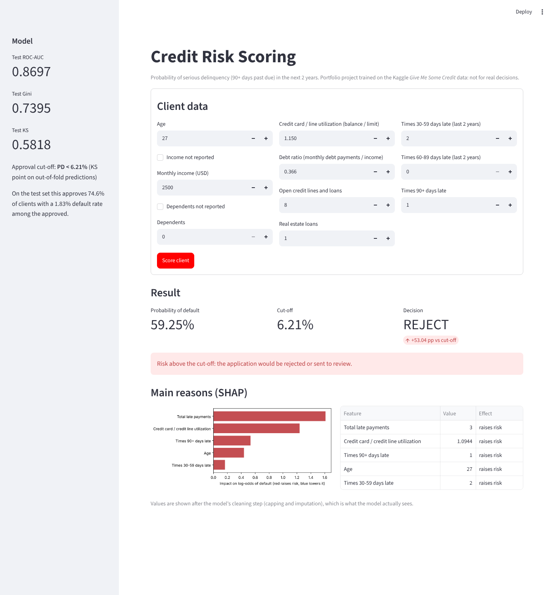
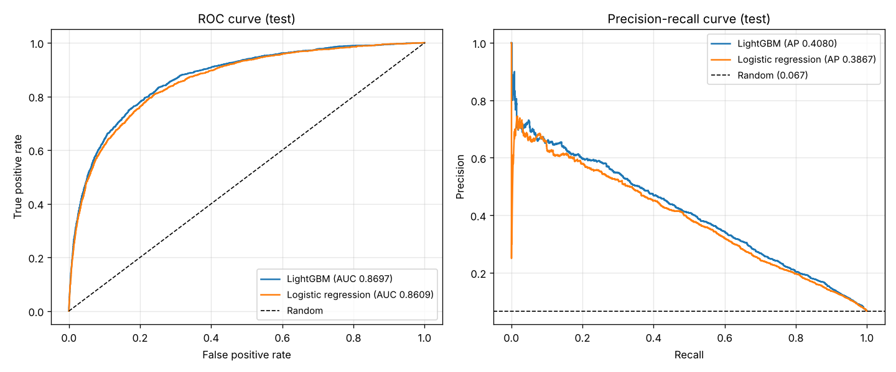
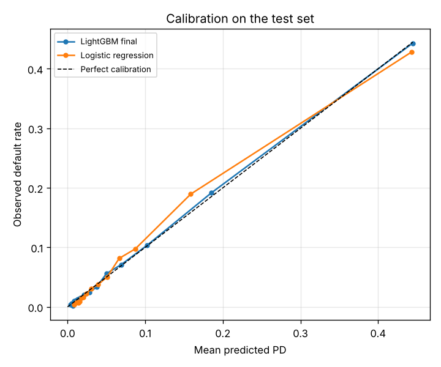
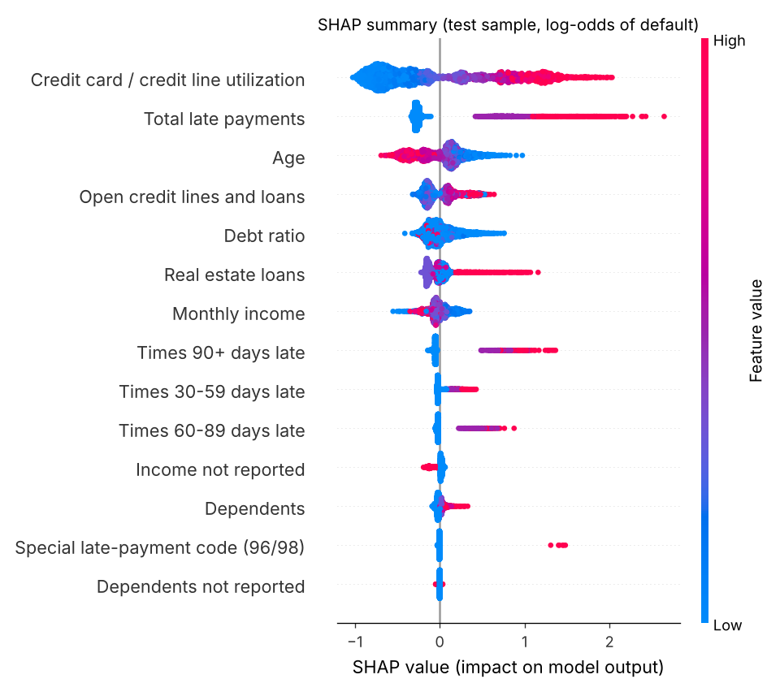
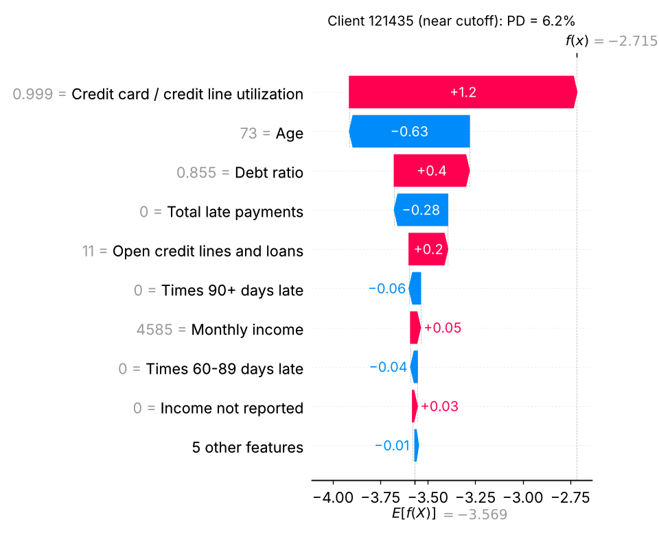
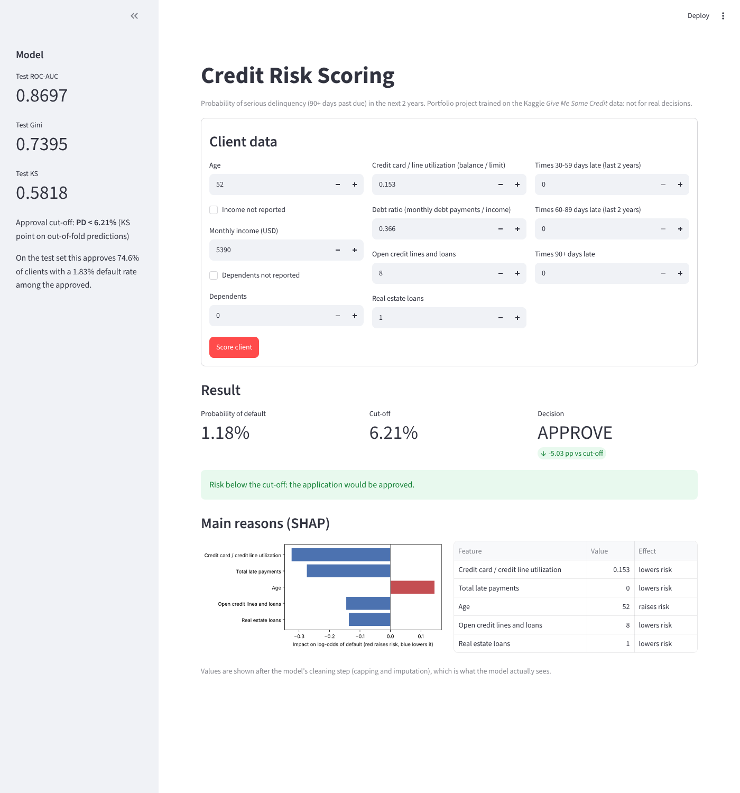

# Credit Risk Model: Probability of Default

[](https://github.com/Alessandro-de-la-Cruz-Valencia/credit-risk-model/actions/workflows/ci.yml)

A credit-scoring model that estimates the **probability that a borrower becomes 90+ days past
due within the next two years**, built the way a retail lender would: a reproducible scikit-learn
pipeline, an interpretable baseline, a gradient-boosting champion model, banking metrics on an
untouched test set, a cut-off table for the approval policy, probability calibration checks,
SHAP explanations and a Streamlit app that scores a single applicant.



## Problem

Lenders need to rank applicants by risk and turn that ranking into an approve / reject decision.
Two things matter:

- **Ranking quality:** riskier clients should get higher scores (measured with AUC, Gini, KS).
- **Probabilities on the right scale:** a predicted 5% PD should mean ~5 defaults per 100 such
  clients, because PDs feed pricing, provisions and expected loss (measured with Brier / calibration).

## Data

[Give Me Some Credit](https://www.kaggle.com/c/GiveMeSomeCredit/data) (Kaggle, 2011): 150,000
US borrowers, 10 numeric features and the target `SeriousDlqin2yrs` (6.68% positives).

The data is **not included** in this repository because of Kaggle's competition rules:

1. Sign in to Kaggle, open the competition's **Data** tab and accept the rules.
2. Download `cs-training.csv` (or `kaggle competitions download -c GiveMeSomeCredit`).
3. Place it at `data/raw/cs-training.csv`.

Only `cs-training.csv` is used; Kaggle's `cs-test.csv` has no labels.

## Methodology

| Step | What | Why |
|---|---|---|
| Split | Stratified 80/20 train/test, fixed seed (`src/data.py`) | The test set is used **once**, at the very end. The EDA and every decision use the training set only. |
| EDA | `notebooks/01_eda.ipynb` | Missing values, outliers, target balance and each feature vs default, with written conclusions. |
| Cleaning | `CreditDataCleaner` (`src/features.py`) | Late-payment codes 96/98 → missing + flag; `age < 18` → missing; missing-income and missing-dependents flags (missingness is informative); 99th-percentile caps learned in `fit`; `TotalPastDue` feature. |
| Pipeline | `src/pipeline.py` | Cleaning → median imputation → (log + scaling for the linear model). Everything is fitted inside the pipeline, so cross-validation folds never leak. |
| Baseline | Logistic regression, scaled, with `log1p` on skewed features | Interpretable reference. The log transform won in all 5 folds. |
| Main model | LightGBM, randomized search of 30 candidates × 5-fold stratified CV, optimizing ROC-AUC | Captures the non-linear and U-shaped relationships found in the EDA. |
| Imbalance | `class_weight="balanced"` vs nothing, for both models | Accuracy is not used: predicting "never defaults" already gives 93.3% accuracy. |
| Calibration | Raw vs Platt vs isotonic on out-of-fold predictions | Decide whether the probabilities need correcting, without touching the test set. |
| Cut-off | KS point of the out-of-fold PDs | Chosen on training data, then reported on test. |
| Explainability | SHAP `TreeExplainer` | Global importance and per-client reasons (also shown in the app). |

## Results

All numbers below are copied from `reports/metrics/` as produced by `python -m src.train`
(4 decimals, not rounded up). Re-running the script gives identical results.

### Cross-validation on the training set (5-fold stratified, mean ± std)

| Model | ROC-AUC | Gini | KS | PR-AUC | Brier |
|---|---|---|---|---|---|
| Logistic regression (scaled) | 0.8497 ± 0.0047 | 0.6994 | 0.5412 | 0.3781 | 0.0507 |
| Logistic regression (log + scaled) | 0.8548 ± 0.0046 | 0.7095 | 0.5549 | 0.3827 | 0.0500 |
| Logistic regression, `class_weight="balanced"` | 0.8552 ± 0.0046 | 0.7103 | 0.5541 | 0.3809 | 0.1456 |
| **LightGBM (tuned)** | **0.8659 ± 0.0035** | **0.7318** | **0.5793** | **0.4035** | **0.0489** |
| LightGBM, `class_weight="balanced"` | 0.8653 ± 0.0037 | 0.7306 | 0.5783 | 0.4022 | 0.1378 |

### Final evaluation on the untouched test set (30,000 clients, 2,005 defaults)

| Model | ROC-AUC | Gini | KS | PR-AUC | Brier | ECE |
|---|---|---|---|---|---|---|
| Logistic regression (log + scaled) | 0.8609 | 0.7218 | 0.5678 | 0.3867 | 0.0497 | 0.0051 |
| **LightGBM (final model)** | **0.8697** | **0.7395** | **0.5818** | **0.4080** | **0.0486** | **0.0019** |

A random model would score 0.5 ROC-AUC and 0.0668 PR-AUC (the default rate).



### Cut-off table (test set, LightGBM)

Applicants are approved from lowest to highest PD. "Bad rate" is the default rate among the
approved; the last column is the share of all defaulters that the policy rejects.

| Approval rate | PD cut-off | Approved | Defaults among approved | Bad rate (approved) | Defaulters rejected |
|---|---|---|---|---|---|
| 50% | 0.0210 | 15,000 | 142 | 0.95% | 92.92% |
| 60% | 0.0324 | 18,000 | 209 | 1.16% | 89.58% |
| 70% | 0.0498 | 21,000 | 327 | 1.56% | 83.69% |
| 75% | 0.0632 | 22,500 | 421 | 1.87% | 79.00% |
| 80% | 0.0817 | 24,000 | 530 | 2.21% | 73.57% |
| 85% | 0.1128 | 25,500 | 672 | 2.64% | 66.48% |
| 90% | 0.1775 | 27,000 | 890 | 3.30% | 55.61% |
| 95% | 0.3315 | 28,500 | 1,266 | 4.44% | 36.86% |
| 100% | 0.8748 | 30,000 | 2,005 | 6.68% | 0.00% |

**Operating point used by the app:** PD < 0.0621 (the KS point on out-of-fold training
predictions). On the test set it approves 74.61% of applicants with a 1.83% bad rate among the
approved, rejecting 79.55% of the defaulters.

### Findings, including the less flattering ones

- **LightGBM beats the baseline, but only modestly:** +0.0088 ROC-AUC and +0.0177 Gini on test.
  With only 10 raw features, a well-prepared logistic regression already captures most of the
  signal; the gain comes from non-linear shapes (utilization above 100%, U-shaped credit lines).
- **Test scores are slightly higher than CV** (0.8697 vs 0.8659 for LightGBM, 0.8609 vs 0.8548 for
  the logistic model). Nothing was tuned on the test set; this is the normal variation of a single
  30,000-row sample (for LightGBM the gap is 0.0038, about one CV standard deviation).
- **`class_weight="balanced"` does not help.** Ranking metrics are unchanged (within CV noise), but
  the Brier score almost triples (0.0489 → 0.1378 for LightGBM) because the weights inflate every
  PD. For a PD model this is a net loss, so the final model uses no weighting. Class imbalance is
  handled with stratified splits, ranking metrics and a business cut-off instead.
- **Calibration was checked and not needed.** On out-of-fold predictions the raw LightGBM PDs have
  ECE 0.0011 and mean PD 0.0667 vs an observed default rate of 0.0668. Platt scaling left the Brier
  score at 0.0489 (a change below 0.0001) and isotonic made it slightly worse (0.0490), so neither was applied
  (rule: calibrate only if Brier improves by at least 1%). Unweighted log-loss training already
  produces calibrated probabilities.
- **Collinearity in the logistic model:** the coefficient of "times 30-59 days late" is negative
  because `TotalPastDue` already contains it. Individual coefficients are therefore not reliable
  to explain on their own; SHAP on the main model is used for explanations instead.



### Explainability (SHAP)

Global importance (mean |SHAP| on a 3,000-client test sample): credit-line utilization (0.668),
total late payments (0.429) and age (0.235) dominate, followed by open credit lines (0.157) and
debt ratio (0.126).



Individual explanations are saved for three test clients (lowest PD, closest to the cut-off and
highest PD): `reports/figures/shap_client_*.png`. Example, a client right at the cut-off:



## App

`app/app.py` (Streamlit): enter an applicant's data and get the PD, the decision against the
cut-off and the five SHAP reasons that moved the score most.

| Approved applicant | Rejected applicant |
|---|---|
|  |  |

## Limitations

- **Old, US-only data.** The dataset is from a 2011 Kaggle competition. Credit behaviour, products
  and the economy have changed, and the population is not representative of other countries.
- **Possible bias.** Age is a strong predictor, and age is a protected attribute in many lending
  regulations (e.g. the US Equal Credit Opportunity Act). Number of dependents and income can act
  as proxies for other protected characteristics. No fairness analysis was done beyond this note.
- **Missing context.** There is no information on loan amount, product, collateral or the
  application date, so the model cannot estimate expected loss or be validated out of time.
- **Data quality.** Several fields show coding problems (96/98 codes, utilization up to 50,708,
  debt ratios computed without income). The cleaning rules are reasonable guesses, not documented
  definitions.
- **Not for real decisions.** This is a portfolio project. A production scorecard would need
  out-of-time validation, monitoring for drift, regulatory review and adverse-action reason codes.

## How to run

Requires Python 3.11+ (developed and tested on 3.13).

```bash
git clone https://github.com/Alessandro-de-la-Cruz-Valencia/credit-risk-model.git
cd credit-risk-model
python -m venv .venv
source .venv/bin/activate        # Windows: .venv\Scripts\activate
pip install -r requirements.txt

# put the Kaggle file at data/raw/cs-training.csv, then:
python -m src.train              # full pipeline end to end (~5 minutes on 4 cores)
streamlit run app/app.py         # the scoring app
pytest                           # unit tests (no data needed)
ruff check . && ruff format --check .
```

`python -m src.train` writes every metric to `reports/metrics/`, every figure to
`reports/figures/` and the model to `models/credit_model.joblib` (not committed).

## Project structure

```
data/raw/            cs-training.csv (not committed)
notebooks/           01_eda.ipynb: exploratory analysis with written conclusions
src/
  data.py            loading and the fixed stratified train/test split
  features.py        CreditDataCleaner: cleaning rules as a scikit-learn transformer
  pipeline.py        preprocessing and model pipelines
  models.py          logistic regression, LightGBM and the search space
  validation.py      stratified cross-validation
  metrics.py         AUC, Gini, KS, PR-AUC, Brier
  calibration.py     out-of-fold calibration and calibration error
  evaluation.py      cut-off table and plots
  explain.py         SHAP helpers
  train.py           end-to-end training script
app/                 Streamlit app
tests/               pytest suite (synthetic data)
reports/             metrics, figures and app screenshots
```

## License

[MIT](LICENSE) © Alessandro de la Cruz Valencia
